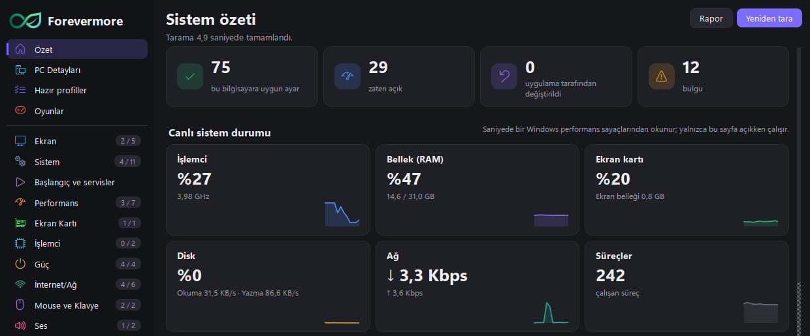

  

<h1 align="center">Forevermore</h1>

  <b>Placebo değil, gerçekten işe yarayan Windows ayarları.</b> 
  <i>No placebo. Windows settings that actually work.</i>

  <a href="https://slimelyw.github.io/forevermore/">Web sitesi</a> ·
  <a href="https://github.com/SlimelyW/forevermore/releases/latest/download/Forevermore.zip">İndir (Windows)</a> ·
  <a href="https://buymeacoffee.com/forevermore">Buy Me a Coffee</a> ·
  <a href="#english">English</a>

---

## Forevermore nedir?

Forevermore, oyuncular için bir Windows 10 / 11 ayar uygulamasıdır. Bilgisayarınızı tarar, her ayarın ne yaptığını
artısı ve eksisiyle sade bir dille anlatır; internette dolaşan "FPS artırır", "ping düşürür" gibi placebo ve zararlı
ayarları ayrıca işaretler. Her değişiklik yedeklenir ve tek tıkla geri alınır.

Uzun zamandır bilgisayar ve optimizasyon işleriyle hobi olarak ilgileniyorum. İnternette çok fazla yanıltıcı ayar ve
asılsız optimizasyon olduğu için kendi testlerime, ölçümlerime ve deneyimlerime dayanan, basit bir uygulama yapmak
istedim. Forevermore bir üniversite öğrencisinin hobi projesidir.

## Özellikler

- **Tarama ve açıklama:** donanımı ve mevcut ayarları salt okuyarak tarar; her ayarın ne yaptığını, kimlerin
  dokunmaması gerektiğini yazar.
- **Placebo ve zararlı ayarlar:** işe yaramayan ya da zarar veren yaygın ayarları ayrı gösterir, bilgisayarınızda
  uygulanmış olanları bulur.
- **Her şey geri alınabilir:** değişiklikten önce yedek ve geri yükleme noktası; Değişiklikler sayfasından tek tıkla geri alma.
- **Ekran kartı ayarları:** NVIDIA ve AMD sürücü ayarları (gecikme, ölçekleme, G-SYNC).
- **Oyun profilleri** *(Pro)*: oyun başına işlemci önceliği, çekirdek seçimi, bildirimleri susturma; oyun açılınca
  otomatik uygulanır, kapanınca geri alınır.
- **Önce / Sonra ölçümü** *(Pro)*: FPS, gecikme ve zamanlayıcı ölçümüyle gerçek etkiyi görme.
- Türkçe ve İngilizce arayüz. Telemetri yok.

| | Ücretsiz | Forevermore Pro |
|---|---|---|
| Tarama, açıklamalar, rehberler, rapor | ✓ | ✓ |
| Ayar değişikliği | aynı anda 5 | sınırsız |
| Hazır profiller, Oyunlar, Önce / Sonra | — | ✓ |
| Geri alma | ✓ | ✓ |
| Fiyat | ücretsiz | ₺250 / ay, 7 gün deneme, 1 bilgisayar |

## Kurulum

1. [Forevermore.zip](https://github.com/SlimelyW/forevermore/releases/latest/download/Forevermore.zip) dosyasını indirin.
2. Bir klasöre açın ve **Forevermore.exe**'yi çalıştırın. Ayar değiştirmek için yönetici izni ister; "Hayır" derseniz
   salt okunur modda açılır.
3. Pro için: uygulamada **Lisans** sayfasına anahtarınızı girin.

Kaldırmak için: Ekstra ayarlar > "Kaldırmaya hazırla" ile değişiklikleri geri alın, sonra klasörü silin.

## Orijinal kopya mı?

Forevermore'u yalnızca bu depodan ya da web sitesinden indirin.

- Uygulamanın **Bilgi** sayfası "Orijinal kopya" yazmalı ve imza parmak izi şu olmalı: `5FE5-D786-0B89-A56E`
- Her sürümün zip SHA-256 değeri [Releases](https://github.com/SlimelyW/forevermore/releases) sayfasında yazar.

> **Antivirüs uyarısı hakkında:** Forevermore Python ile yazılıp PyInstaller ile paketlenir; bu yöntemle paketlenen
> programlar küçük antivirüslerde sık sık yanlış alarm verir. 2.0.0 sürümünde
> [VirusTotal](https://www.virustotal.com/gui/file/98fae42651a4a68571f01d4f5bef7a0e905cab99ba0f30c764188b2ea6f219e0)'da
> 64 motordan yalnızca biri (Zillya, "Trojan.Blank") uyarı veriyor. SmartScreen'in "bilinmeyen yayımcı" uyarısı kod
> imzalama sertifikası olmamasından kaynaklanır. Yukarıdaki değerler tutuyorsa dosya yayımlandığı gibidir.

## Gizlilik

Telemetri, reklam, analiz yok. Tarama sonuçları bilgisayarınızdan çıkmaz. Yalnızca Pro lisansı doğrulanırken lisans
anahtarı ve bilgisayarın anonim kimliği ödeme ortağımız Lemon Squeezy'ye gönderilir.
Ayrıntı: [Gizlilik](https://slimelyw.github.io/forevermore/gizlilik.html).

## Lisans

© 2026 Kubilay Paşa. Tüm hakları saklıdır. **Bu depo yalnızca web sitesini ve indirme dosyasını içerir; uygulamanın
kaynak kodu açık değildir.** Forevermore kişisel kullanım için sunulur; satılamaz, değiştirilip dağıtılamaz, başka bir
ad veya yapımcı adıyla sunulamaz. Tam metin: [Kullanım koşulları](https://slimelyw.github.io/forevermore/kosullar.html).

İletişim: Discord **smileyw** · Destek olmak için: [buymeacoffee.com/forevermore](https://buymeacoffee.com/forevermore)

---

## English

Forevermore is a Windows 10 / 11 settings app for gamers. It scans your PC, explains what each setting does with its
pros and cons, and flags the placebo and harmful tweaks that circulate online ("more FPS", "lower ping"). Every change
is backed up and can be undone with one click. It is a university student's hobby project, based on my own tests,
measurements and experience.

- **Free:** scan, explanations, guides, report, 5 setting changes at a time, undo.
- **Pro (₺250 / month, 7-day trial, 1 computer):** unlimited changes, profiles, per-game settings, Before / After measurement.
- **Download:** [Forevermore.zip](https://github.com/SlimelyW/forevermore/releases/latest/download/Forevermore.zip) →
  extract → run **Forevermore.exe**.
- **Genuine copy:** the About page says "Original copy" and shows the signature fingerprint `5FE5-D786-0B89-A56E`.
- **Antivirus warnings:** PyInstaller-packaged apps often get false alarms from smaller engines; for 2.0.0 only one of
  64 engines on [VirusTotal](https://www.virustotal.com/gui/file/98fae42651a4a68571f01d4f5bef7a0e905cab99ba0f30c764188b2ea6f219e0)
  (Zillya) flags it.
- **Privacy:** no telemetry; only the license key and an anonymous computer ID are sent when a Pro license is verified.
  [Privacy policy](https://slimelyw.github.io/forevermore/gizlilik.html#en)
- **License:** © 2026 Kubilay Paşa. All rights reserved. This repository contains only the website and the download;
  the source code is not public. [Terms](https://slimelyw.github.io/forevermore/kosullar.html#en)

Contact: Discord **smileyw** · Support the project: [buymeacoffee.com/forevermore](https://buymeacoffee.com/forevermore)
